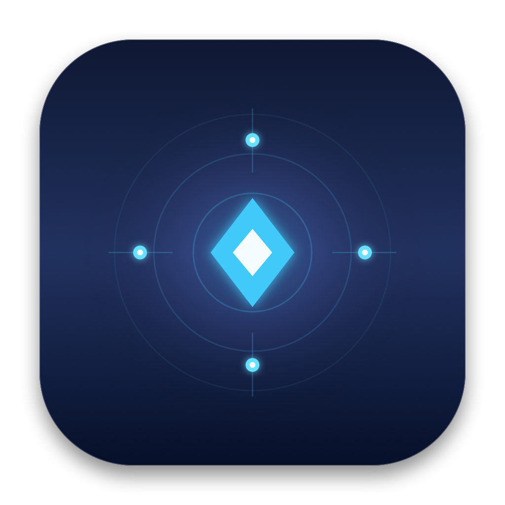

# Waypoint ⚡
### Native macOS Local-First Ecosystem Bridge & Continuity Utility

<p align="center">
  
</p>

<p align="center">
  <b>Seamlessly connect your Mac to Android, iOS, Windows, and Linux devices over local Wi-Fi without internet, accounts, or cloud servers.</b>
</p>

<p align="center">
  
  
  
  
</p>

---

## 🌟 Overview

**Waypoint** is a lightweight, high-performance macOS menu-bar application written purely in native Swift (using SwiftUI and AppKit). It runs discreetly in the status bar (with no Dock footprint) and provides a unified bridge to all your personal devices on the local Wi-Fi network.

Whether sharing multi-gigabyte files, synchronizing text clips, relaying Android notifications to macOS Notification Center, or mirroring screens with hardware acceleration, Waypoint communicates **100% peer-to-peer**.

---

## 🚀 Key Features

### 1. Menu Bar Status Item & Modern Popover UI
- **Zero Dock Clutter:** Declared as an accessory (`LSUIElement = 1`), living exclusively in the macOS menu bar.
- **Glassmorphic Popover Dashboard:** Built with SwiftUI vibrancy, tabbed navigation, live peer discovery radars, and drag-and-drop beaming zones.
- **Dynamic Status Indicator:** Visual cues for local listener state, connected peers, and transfer activities.

### 2. Engine 1: High-Speed P2P Network (Network.framework)
- **Zero-Configuration Discovery:** Automatically announces and discovers peers using Bonjour (`_waypoint._tcp`).
- **Chunked File Streaming:** Transfers large files via buffered 64KB TCP chunks, writing directly to `~/Downloads/Waypoint Received`.
- **Integrity Verification:** End-to-end SHA-256 checksumming with progress tracking.

### 3. Engine 2: Local HTTP Fallback Web Server (Guest Mode)
- **Universal Guest Access:** Built-in zero-dependency HTTP server running on a dynamic local IP and port.
- **Instant QR Pairing:** Generates a real-time QR code via CoreImage (`CIQRCodeGenerator`) for mobile cameras.
- **Rich Responsive Web Dashboard:** Any device with a browser (Windows, Android, guest iPhone) can download staged files and beam clipboard text to your Mac.

### 4. Advanced Ecosystem Continuity Modules
- **Universal Clipboard Sync:** Non-intrusive `NSPasteboard` change count tracking with SHA-256 hash ring deduplication to prevent echo loops.
- **Notification Relay Receiver:** Displays notifications from companion Android phones natively via `UserNotifications` with quick reply support.
- **Media Control Bridge:** Two-way remote control commands and metadata synchronization with macOS audio players.
- **Low-Latency Screen Mirroring:** Hardware-accelerated H.264 NAL parsing pipeline directly feeding `AVSampleBufferDisplayLayer` with sub-25ms latency.

---

## 🏛 Architecture & Wire Protocol

```
┌────────────────────────────────────────────────────────┐
│                      Waypoint.app                      │
│                  (macOS Menu Bar Item)                 │
└───────────────────────────┬────────────────────────────┘
                            │
       ┌────────────────────┴────────────────────┐
       ▼                                         ▼
┌──────────────────────────────┐   ┌──────────────────────────────┐
│  Engine 1: P2P Network Core  │   │  Engine 2: Local Web Server  │
│  • Bonjour (_waypoint._tcp)  │   │  • Fallback Guest Mode       │
│  • NWListener & NWConnection │   │  • CoreImage QR Code Gen     │
│  • Binary Framing Protocol   │   │  • Browser Download / Upload │
└──────────────┬───────────────┘   └──────────────────────────────┘
               │
    ┌──────────┼──────────┬──────────┐
    ▼          ▼          ▼          ▼
┌────────┐ ┌────────┐ ┌────────┐ ┌────────┐
│  File  │ │ Clipbd │ │ Notif  │ │ Video  │
│ Stream │ │  Sync  │ │ Relay  │ │ Decode │
└────────┘ └────────┘ └────────┘ └────────┘
```

### Binary Wire Protocol
All TCP communications use a binary 10-byte header format:
```
 0                   1                   2                   3
 0 1 2 3 4 5 6 7 8 9 0 1 2 3 4 5 6 7 8 9 0 1 2 3 4 5 6 7 8 9 0 1
+-+-+-+-+-+-+-+-+-+-+-+-+-+-+-+-+-+-+-+-+-+-+-+-+-+-+-+-+-+-+-+-+
|                      Magic "WAYP" (0x57415950)                |
+-+-+-+-+-+-+-+-+-+-+-+-+-+-+-+-+-+-+-+-+-+-+-+-+-+-+-+-+-+-+-+-+
|    Version    |  Packet Type  |     Payload Length (MSB)      |
+-+-+-+-+-+-+-+-+-+-+-+-+-+-+-+-+-+-+-+-+-+-+-+-+-+-+-+-+-+-+-+-+
|       Payload Length (LSB)    |        Payload Bytes...       |
+-+-+-+-+-+-+-+-+-+-+-+-+-+-+-+-+-+-+-+-+-+-+-+-+-+-+-+-+-+-+-+-+
```

For detailed protocol specifications, see [ECOSYSTEM_ARCHITECTURE.md](ECOSYSTEM_ARCHITECTURE.md).

---

## 📂 Project Structure

```
Waypoint/
├── Package.swift                          # SwiftPM package configuration
├── Info.plist                             # macOS application bundle properties & permissions
├── build_app.sh                           # One-click release compilation & bundle builder
├── ECOSYSTEM_ARCHITECTURE.md              # Deep-dive continuity protocol specifications
├── README.md                              # Project documentation
├── Assets/
│   ├── WaypointLogo.png                   # 1024x1024 master icon
│   ├── AppIcon.icns                       # Native macOS icon bundle
│   └── AppIcon.iconset/                   # Multi-resolution icon set
├── Sources/
│   └── Waypoint/
│       ├── WaypointApp.swift              # App lifecycle, NSStatusItem & NSPopover
│       ├── P2PNetworkManager.swift        # NWListener, NWBrowser & TCP socket engine
│       ├── LocalWebServer.swift           # Zero-dependency HTTP server & web UI
│       ├── ContinuityManager.swift        # NSPasteboard watcher & UNNotificationCenter
│       ├── PopoverView.swift              # SwiftUI dashboard & drag-and-drop zone
│       ├── VideoStreamingPipeline.swift   # AVSampleBufferDisplayLayer H.264 engine
│       ├── Models/
│       │   ├── PacketProtocol.swift       # Header layout & wire framing
│       │   └── EcosystemProtocols.swift   # Handshake, clipboard, notif & media models
│       └── Utilities/
│           ├── NetworkUtilities.swift     # Interface IP resolver (en0 / Wi-Fi)
│           └── QRGenerator.swift          # CoreImage CIQRCodeGenerator wrapper
└── Tests/
    └── WaypointTests/
        └── WaypointTests.swift            # Suite of protocol & codec verification tests
```

---

## 🛠 Building & Running

### Requirements
- macOS 14.0 (Sonoma) or newer (including macOS Sequoia)
- Xcode 15+ / Swift 6.0+

### Option 1: One-Click App Bundle Build
Run the build script to compile in release mode and generate `Waypoint.app`:
```bash
./build_app.sh
open ./Waypoint.app
```

### Option 2: Swift Package Manager
```bash
# Debug build
swift build

# Run unit tests
swift test

# Run directly from terminal
swift run Waypoint
```

---

## 🔒 Privacy & Security

- **Zero Cloud Footprint:** No external network requests, analytics, or telemetry.
- **Air-Gapped Operation:** Works flawlessly on isolated Wi-Fi access points without internet.
- **Local Storage:** Incoming files are safely written only to `~/Downloads/Waypoint Received`.

---

## 📄 License

Distributed under the MIT License.
